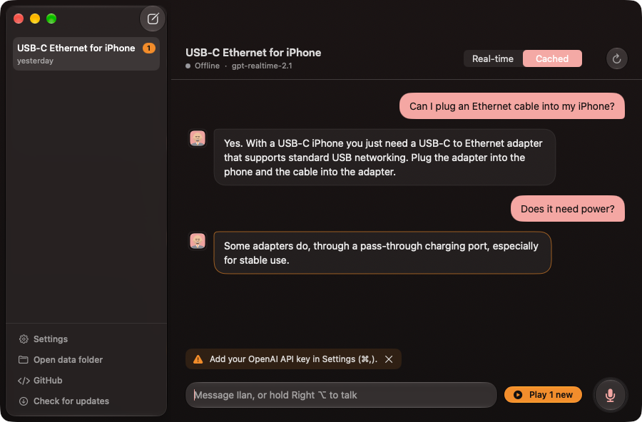

<p align="center"></p>

<h1 align="center">Ilan Voice</h1>

<p align="center">
  A native macOS voice assistant on OpenAI's <b>GPT-Realtime</b>: hold a key, talk, let go.<br>
  Your own agent, your own MCP tools, and every word saved on your Mac.
</p>

<p align="center">
  
  
  
  
</p>

<p align="center"></p>

## Highlights

- 🎙️ **Push to talk, from any app.** Hold right ⌥ (or any key or mouse button), speak, let go. Ilan never cuts in while you pause.
- ⌨️ **Or type.** A message box under the conversation; Ilan still answers out loud.
- 🧠 **Your own agent.** Instructions come from an `agent.md` you write.
- 🔌 **Your MCP tools.** Any MCP server, in the same `mcpServers` format as Claude Code (import it in one click).
- 🐚 **Shell, files and web search** as optional built-in tools, with an allow-list you control.
- 📱 **iPhone.** Talk to Ilan from your home screen over your own tailnet.
- 📝 **Everything saved.** Full transcripts, every tool call, and a WAV for every voice message.
- 💸 **Cost at a glance.** Tokens per reply and cost per conversation.

## Quick start

You only need the Xcode Command Line Tools (`xcode-select --install`); full Xcode isn't required.

```fish
git clone git@github.com:Shi-Dong/ilan-voice.git
cd ilan-voice
scripts/build-app.sh --install   # builds dist/Ilan Voice.app and copies it to /Applications
open "/Applications/Ilan Voice.app"
```

Then, on first launch:

1. **OpenAI key.** Settings (⌘,) → General → **Set API Key…**. The key is checked with OpenAI before it is saved, and only a short hint such as `sk-…a1b2` is ever shown again.
2. **Microphone.** Allow access when macOS asks.
3. **Accessibility.** Click **Allow Accessibility** at the bottom of the window, so the talk key works in every app. The first build creates a private self-signed certificate (in `~/Library/Application Support/Ilan Voice/signing/`) and signs every later build with it, so macOS keeps the permission across updates. Upgrading from an older build? Remove the old Ilan Voice entry under Privacy & Security → Accessibility and allow it once more.

## Talking to Ilan

### Push to talk

Hold the talk key, speak, and let go: releasing the key ends your message. Right ⌥ is the default; to change it, click **Change…** in Settings → General and press any key or mouse button.

| Do this | And Ilan… |
| --- | --- |
| **Hold** the talk key | listens until you let go |
| **Tap** it while Ilan talks or works | stops (after a brief wait to see whether a second tap follows) |
| **Double-tap** it | keeps going, and the window comes to the front with the cursor in the message box |

While you talk, a small floating pill near the bottom of the screen shows live voice bars and which microphone is recording, over any app:

<p align="center"></p>

### Typing

The message box is focused whenever you open the window. **Enter** sends, **Shift+Enter** adds a line, ⓧ clears it; Ilan answers out loud as usual.

- An unsent draft is kept across closing the window, switching conversations and restarts.
- Holding the talk key still works while the box has text: only your voice is sent, and the draft stays.
- Select text in the conversation and click **Ask about this** (it appears right under your pointer, or right-click → **Ask about this**) to quote it into the box.

The iPhone web app stays voice-only.

### Hearing replies

| Mode | What happens |
| --- | --- |
| **Real-time** | The reply plays while it is still being generated. Hold the talk key to cut it off. |
| **Cached** | The reply is saved and marked **NEW**. Play it when you're ready with its ▶ button, **Play new**, or ⇧⌘P. |

**Replay key (optional).** Set **Replay last reply** in Settings → General, and pressing it in any app plays Ilan's last reply again from the start, cutting off whatever Ilan is saying. Tapping the talk key stops the replay. Also in the menu bar icon and under Voice → Replay Last Reply (⇧⌘L).

### Your words, spelled right

- **Dictionary.** Settings → Dictionary holds your own words (names, jargon, acronyms): type one to add it, click the trash icon to delete it, or **Import…** a text file with one per line. They are sent to the transcription model as a hint and to Ilan as a vocabulary list. Stored in `dictionary.txt` next to `agent.md`.
- **Transcript repair.** Before each turn, the transcription model is told what Ilan said last. After Ilan answers, a small text model (GPT-6 Luna by default) fixes misheard words using the dictionary, the conversation and Ilan's reply. The original is kept in `conversation.json` as `rawText`.
- **Titles.** After every reply, the same model names the conversation (at most 30 characters). Renaming a conversation yourself turns this off for it. Change the model under Settings → General → Title model.

## Tools

### MCP servers

Ilan can call any MCP server in `mcp.json`, remote (Streamable HTTP) or local (stdio). Each tool is shown to the model as `<server>__<tool>`.

```json
{
  "mcpServers": {
    "memory": { "type": "http", "url": "https://example.com/mcp", "headers": { "Authorization": "Bearer ${MEMORY_TOKEN}" } },
    "files":  { "command": "npx", "args": ["-y", "@modelcontextprotocol/server-filesystem", "/Users/me/notes"] }
  }
}
```

### Shell commands (optional)

Turn on Settings → Shell and Ilan can run bash commands on your Mac with its `run_shell` tool. It never asks for permission:
- commands on your allow-list run straight away;
- everything else is refused, and Ilan tells you what to add.

The default list is read-only (`ls`, `cat`, `grep`, `git status`, `git log`, `kubectl get`, …).

<details>
<summary>Allow-list rules, sessions and the bypass switch</summary>

- **Rules.** Each line is either a command prefix (whole words: `ls` does not allow `lsof`) or a regular expression in slashes that must match the whole command, e.g. `/kubectl -n [a-z-]+ (get|describe) .*/`.
- **Always refused.** Pipes, `&&` and `;` work when every part is allowed. Writing to files (`>`), `$( )`, backticks and background `&` are always refused, as are writing flags such as `find -delete` or `git branch -D`.
- **Sessions.** Each conversation gets one persistent bash session, started in the directory you choose, so `cd`, exported variables and activated environments carry over. A command is stopped after the timeout (60 s by default) while the session lives on. Every command appears in the transcript with its output.
- **Closing sessions.** Ilan can end a session with `close_shell`. Conversations with an open session show a light red terminal icon in the sidebar; click it (or right-click the conversation) to close it yourself. Quitting the app closes them all.
- **Bypass all permissions.** A red switch, behind a warning. It lets every command run unchecked, lets the file tools change any file (ignoring the block list), and greys out the rest of the Shell tab. Use it with care.

</details>

### Files

Ilan can always read text files with `read_file`. One switch in Settings → Shell → Files also lets it edit files (`edit_file`, replacing an exact piece of text) and create or overwrite them (`write_file`). This works anywhere except the block list, which covers macOS's own folders by default.
- Every change is first backed up to `file-backups/` next to `agent.md`.
- SSH, AWS and GnuPG keys, the Keychain and Ilan's own secrets are never read or changed.

### Web search

Settings → General → Web Search → **Set API Key…** next to *Gemini API key*. The key is checked with Google before it is saved. Ilan then gets a `web_search` tool: Gemini (`gemini-3.8-flash` by default) answers with Grounding with Google Search, and the answer and its sources appear in the transcript.

## iPhone

Settings → General → iPhone → **Start Web Server** lets you talk to Ilan from your iPhone's home screen.

1. Install [Tailscale](https://tailscale.com) on the Mac and the iPhone. The page is published on this Mac's tailnet name over HTTPS (`tailscale serve`, port 8767), reachable only from your own devices.
2. Scan the QR code, open the page, then Share → **Add to Home Screen**.
3. Hold the button while you talk. Slide your finger up while holding to cancel instead of sending.

<details>
<summary>More about the iPhone app</summary>

- **Replies** always play in real time. The Reconnect button at the top starts a fresh session.
- **One conversation per iPhone.** Each iPhone has its own conversation ("iPhone 1", "iPhone 2", …), marked with an iPhone in the sidebar. You can continue it on the Mac, and several iPhones can be used at once.
- **Same setup as the Mac.** It uses the same instructions, tools and settings.
- **After reinstalling.** If you remove the home-screen app and add it again, the page asks "Which iPhone is this?"; pick the old name to carry on with its conversation.
- **Pairing code.** The link carries a pairing code; **New Pairing Code…** makes old links stop working.

</details>

## Cost

Each conversation's cost so far appears in the sidebar. Each reply shows the tokens it used, on the same line as its replay button: input (of which cached) and output. Tool-calling steps are counted with the reply that follows them.

- **What's counted:** only the realtime voice model, including replies you cut off. Transcription, transcript corrections, titles and web search are not included.
- **Prices:** worked out from OpenAI's list prices. A model with no known price is marked with "+" instead of being guessed.
- **Hiding:** turn the numbers off in Settings → General → Cost; they are still recorded.

## Settings and files

Settings → General also covers:
- **Speaking speed:** 0.5× to 1.5× in steps of 0.1, applied from the next reply.
- **Microphone:** the Mac's built-in one by default, so Bluetooth headphones stay in high-quality mode.
- **Model and voice:** the model, and a female or male voice.
- **Other:** reasoning effort, transcription model, talk key and output mode.

**Dock.** Closing the window hides Ilan Voice from the Dock; it keeps running in the menu bar, so the talk key still works. **Show Ilan Voice** in the menu bar icon brings both back. Turn this off in Settings → General → App.

Everything lives in `~/Library/Application Support/Ilan Voice/`:

```
agent.md                      the agent's instructions (Settings → Agent reveals or opens it)
mcp.json                      MCP servers (Settings → MCP Tools reveals or opens it)
dictionary.txt                your words, one per line (Settings → Dictionary)
secrets.json                  API keys, readable only by your user account
Conversations/<id>/
    conversation.json         the full record
    transcript.md             the same record, easy to read
    audio/<item>.wav          every voice message, yours and the assistant's
```

**API keys.** Every key is stored by name (`OPENAI_API_KEY`, `GEMINI_API_KEY`, …) in `secrets.json`.
- **Why not the Keychain:** it would ask for your password after every update of a self-built app.
- **Using keys in `mcp.json`:** refer to any key as `${NAME}`, so tokens don't have to be pasted into it.
- **Fallback:** a name with no stored value falls back to the environment variable of the same name.

## Updating

Click **Check for Updates** in Settings → General (or **Ilan Voice → Check for Updates…**).

- **Automatic checks:** the app also checks when it starts, every 10 minutes, and when you switch to it if the last check is over 3 minutes old. An orange **Update** button appears when GitHub has a newer version.
- **Installing:** **Install Update** downloads the latest `main` into `~/Library/Application Support/Ilan Voice/source` and builds it on this Mac, with a progress bar. When it's done, click **Restart Now**, or **Later** to apply it when you next quit. The build log is saved to `update.log`.
- **Your data:** settings, `agent.md`, `mcp.json` and conversations are never touched.

Because the app is built on your Mac rather than downloaded, macOS has nothing to block.

## How it works

```
hold key → microphone → 24 kHz PCM → input_audio_buffer.append ─┐
release  → input_audio_buffer.commit + response.create          │  WebSocket
                                                                 ▼
             GPT-Realtime ── function_call → MCP server → function_call_output
                  │
                  ├─ output_audio.delta → speaker (real-time) or WAV only (cached)
                  └─ transcripts → transcript.md / conversation.json
```

- **No voice detection.** It's turned off (`turn_detection: null`), so your message is exactly what you recorded while the key was held.
- **Sessions.** Each conversation gets its own Realtime session. Reopening an old one adds its earlier turns to the instructions.

## Development

| Path | Role |
| --- | --- |
| `Sources/IlanVoice/Core/VoiceSession.swift` | push-to-talk flow, Realtime events, tool loop, playback modes |
| `Sources/IlanVoice/Core/RealtimeClient.swift` | WebSocket client |
| `Sources/IlanVoice/Core/MCP.swift` | MCP client (HTTP and stdio) |
| `Sources/IlanVoice/Core/ConversationStore.swift` | transcripts on disk |
| `Sources/IlanVoice/Audio/Audio.swift` | microphone capture, streaming playback, WAV |
| `Sources/IlanVoice/Views/` | SwiftUI interface |
| `scripts/build-app.sh` | builds the `.app` bundle |
| `scripts/test.sh` | builds and runs the unit tests in `Tests/IlanVoiceTests` |

**Tests.** `scripts/test.sh` compiles the app's code as a library, links the tests in `Tests/IlanVoiceTests` against it and runs them in a few seconds. The same script runs on every pull request.
- **Isolation:** the tests run with a throwaway home folder and no API keys, so they never touch your data or call OpenAI. The iPhone web server starts on a spare local port, and Tailscale is never involved.
- **Node.js:** the JavaScript check of the iPhone page needs it and is skipped without it.
- **Harness:** the Command Line Tools include neither XCTest nor Swift Testing's macro plugin, so the tests use a small built-in harness. Group them with `suite("…") { test in test("…") { … } }` and check with `expect(…)` / `expectEqual(…, …)`. A new test file needs a `register…Tests()` function called from `Tests/IlanVoiceTests/main.swift`.
